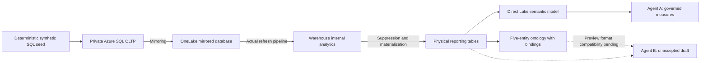

# Azure SQL to Microsoft Fabric Data Agent

A synthetic community-health demonstration: operational appointments, referrals,
programs, facilities, and capacity become governed analytical answers.

> **Current readiness:** The SQL-to-published-agent baseline works live: private
> source, mirroring, actual analytics pipeline, governed tables, Direct Lake refresh,
> and published agent A. All seven live DAX checks and seven published natural-language
> known answers matched the answer card. Four negative prompts disclosed no
> prohibited result; two returned generic safety refusals.
> The new ontology exists and its five-entity/four-relationship editor renders, but
> graph materialization reports unsupported data sources. Ontology-context agent B
> is additionally blocked by a preview format mismatch: its service expects
> `definition.json`, not the new ontology's TMDL. Restricted-identity access tests
> are not run. Present the accepted baseline; treat graph/A-B as conditional.
> Resume the capacities before rehearsal and pause them after use.

Start with the [end-to-end presenter runbook](docs/presenter-runbook.md): preparation,
upgrade, Fabric portal walkthrough, answer card, ontology binding, two-agent
comparison, evaluation, access tests, fallbacks, and shutdown.
See the [deployment summary](docs/deployment-summary.md) for historical versus current status.

## Architecture



The repository defines the full revised path; remaining portal/pipeline acceptance
is explicit in the runbook. The separate FastAPI starter generates an in-memory dataset; it
does **not** write Azure SQL or feed mirroring.

### Implemented repairs

- Additive source/Warehouse schemas and repeatable synthetic upserts rather than
  dropping existing tables. Non-synthetic source data blocks seeding.
- A fixed `2026-10-01` reference date, 5,000 clients, 90,000 appointments,
  12,000 referrals, and 540 capacity snapshots.
- Nonempty privacy-filtered reporting at the existing minimum of 11 records per
  appointment/referral group; stable aggregate keys and weighted wait arithmetic.
- Five physical `reporting` tables shared by the semantic model and ontology.
  Direct Lake partitions no longer reference SQL views.
- A real, transactional analytics refresh pipeline with native Warehouse item
  authentication and explicit readiness checks; no new SQL/OAuth connection required.
- Fabric operation-result retrieval, pagination, bounded authentication, and
  create/update definitions. Existing ontology definitions are preserved by default.
- Ground-truth [evaluation questions](fabric/data-agent/evaluation_questions.json),
  API/analytics/definition/SQL-runner tests, and dependency-free PowerShell helper tests.
- Explicit agent table selections, publication/read-back, semantic-model refresh,
  and a Windows-native [published-agent MCP runner](scripts/Invoke-FabricDataAgent.ps1).

Canonical reporting totals are **70,944 appointments** and **12,000 referrals**.
The appointment total excludes suppressed groups; it is not all 90,000 source rows.
Average wait is approximately **18.97 days**; referral completion is **50%**.
Deliberately programmed service-level wait bands make the synthetic comparison
visible, not representative of actual community-health services.

### Ontology and agents

The new `CCSF_Community_Health_Demo_Ontology` exists in the **already-existing
companion workspace** `ws-e2e-sql-to-fabricagent-iq`. The authenticated primary
workspace creation request returned `403 FeatureNotAvailable`; no new workspace
or capacity was provisioned. It contains Facility, Program, AccessSummary,
ReferralSummary, and CapacitySnapshot.
Every property has a declared reporting-column binding; four relationships use
real program/facility keys. No person-level client, appointment, or referral source
is exposed through those backing tables.

Warehouse/semantic-model ontology bindings are now documented product capabilities;
the historical "Lakehouse/Eventhouse only" limitation is not generally current.
The older seven-entity conceptual ontology in `ws-e2e-sql-to-fabricagent-iq` remains
untouched. The server accepted and returned the new definition and bindings. The editor
rendered all five entities/four relationships. Graph projection nevertheless
reported every entity Ineligible with "Unsupported Datasource". A same-workspace
Lakehouse with five OneLake shortcuts to only the governed Warehouse tables was
also tested; this did not establish graph execution. No raw-data copy or new
workspace/capacity was needed.

The checked-in configuration updates agent A's draft; `-PublishDataAgent` explicitly
publishes it and verifies read-back. Its three model tables are selected, and the
published MCP experience was rehearsed. Agent B exists only as an unaccepted draft:
the ontology-context service rejected the new TMDL item because it requires the
older root `definition.json` format. Do not mix formats or present B as working.
Ontology supplies business context while underlying sources execute
queries; it does not guarantee better answers. A fair comparison must control
data, permissions, questions, and source/engine differences.

### Supported measures and questions

Implemented: reported appointment counts/completion, no-show rate, appointment-weighted
average wait, referral counts/completion, and facility capacity utilization.

- Which service category has the longest weighted average wait?
- How many reported appointments are available, excluding suppressed groups?
- What percentage of reported referrals were completed?
- How many capacity snapshots exceeded 85% utilization in September 2026?

Not implemented: distinct clients served, encounters per resident, median waits,
travel distances, population-adjusted rates, clinical outcomes, or follow-up rates.
Use fixed date ranges rather than relative dates against this fixed fixture.
No Power BI report has been authored.

## Upgrade and rehearse

Use the [presenter runbook](docs/presenter-runbook.md) for required identity, private
source connection, and native Warehouse pipeline preparation.
Do not recreate infrastructure to repair this existing environment.

```powershell
az login --tenant aa56606c-b0ba-43a8-9c11-eb0144a67efb
.\scripts\Set-FabricCapacityState.ps1 -State Resume -Target All
.\scripts\Deploy-Fabric.ps1 -InitializeSource -PublishDataAgent
.\scripts\Test-Deployment.ps1
```

After the reporting baseline is ready, an independent ontology attempt is:

```powershell
.\scripts\Deploy-Ontology.ps1 -WorkspaceName 'ws-e2e-sql-to-fabricagent-iq'
```

The standalone script still defaults to the primary workspace; pass the supported
companion explicitly in this environment. Existing ontology definitions are preserved; export/review before explicitly using
`-UpdateExisting`. Preserve native lineage tags when reviewing exported definitions.
Live agent accuracy, graph refresh, and effective OneLake/SQL permissions need
separate acceptance checks; successful publication alone is insufficient.

For a published-agent rehearsal on PowerShell 7.4+, use
[Invoke-FabricDataAgent.ps1](scripts/Invoke-FabricDataAgent.ps1); it needs no optional
Python MCP packages. The [Python SDK runner](scripts/Invoke-FabricDataAgent.py) and
[demo requirements](requirements-demo.txt) remain optional. Python HTTPS connection
timeouts were observed here; native HTTP/1.1 completed the same real MCP requests.

## Local API starter

Python 3.12; no cloud database client or direct identifying fields in the API dataset:

```powershell
py -3.12 -m venv .venv
.\.venv\Scripts\Activate.ps1
python -m pip install -r requirements.txt
Copy-Item .env.sample .env
uvicorn main:app --host 127.0.0.1 --port 8000
```

Uvicorn does not automatically load `.env`; set documented variables in the shell
to override defaults. Endpoints: `GET /healthz`, `GET /readyz` (503 if unavailable),
`GET /api/v1/synthetic-data`, and `GET /docs`.

## Tests

With the existing Python 3.12 dependencies and PowerShell 7:

```powershell
$env:PYTHONDONTWRITEBYTECODE = '1'
py -3.12 -m unittest discover -s .\tests -v
.\tests\Test-FabricHelpers.ps1
git --no-pager diff --check
```

SQLite tests independently reproduce the deterministic SQL fixture and exercise
checked-in reporting view logic. They verify known answers and suppression, not
Fabric server-side T-SQL/TMDL acceptance, live agent accuracy, or permissions.

## Privacy and operational boundaries

- Synthetic data only; no real PHI, customer correspondence, secrets, or production
  connection strings in source control. The local `Reference` folder is ignored.
- The private Azure SQL source uses Entra authentication through the existing VNet
  gateway. Do not enable public source access to simplify the demo.
- SQL reporting grants/raw-schema denial are illustrative controls. Test effective
  SQL, OneLake, item, model, workspace, and published-agent access with a restricted
  identity. Instructions and source-selection checkboxes are not security boundaries.
- Small-cell suppression applies to record counts at the declared grain; production
  disclosure protection needs a broader review. Synthetic associations are not causal.
- Pause approved Fabric capacities after use. `-Target Primary` is the default;
  `-Target LegacyOntology` or `All` handles the historical capacity when applicable.
  Azure SQL and some storage costs continue while Fabric is paused.

Any production adaptation requires organizational privacy, security, legal,
data-governance, and responsible-AI review.
